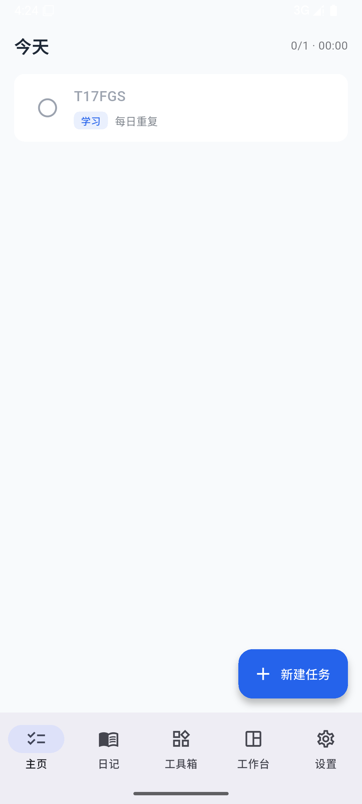
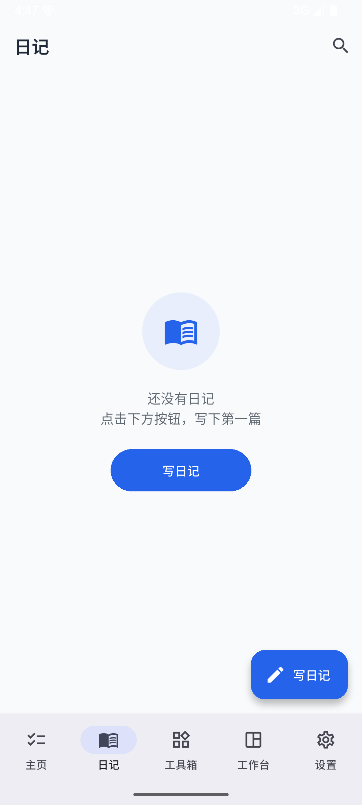
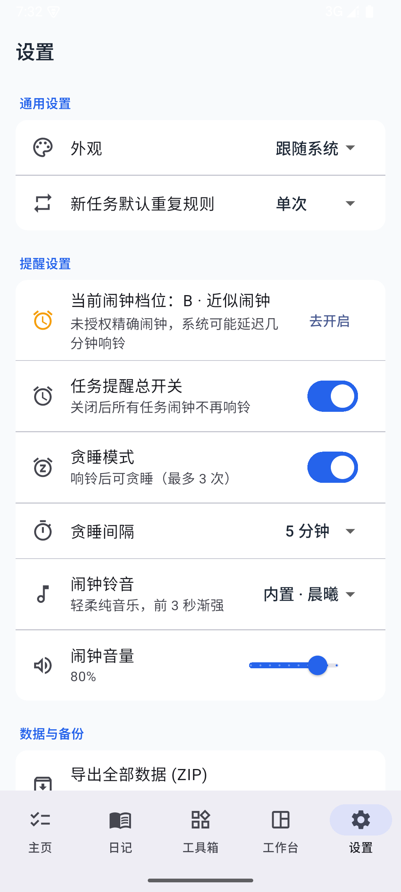

# 效率助手 (Efficiency App) · 豆包实现

> 一个**纯原生、零云端**的安卓效率应用。任务 + 日记 + 5 个工具箱插件，所有数据本地存储。


---

## 为什么做这个

市面上的待办 App 大多要求登录、同步、订阅。这个项目反着来：

- **不要账号** —— 打开就能用
- **不要网络** —— 飞行模式也能跑
- **数据在你手里** —— SQLite 本地存储 + ZIP 导出备份

---

## 功能

### 任务体系
- 单次 / 每日 / 每周重复
- 三态：未完成 → 计时中 → 已完成（**真计时**，每秒刷新）
- 精确闹钟 + 贪睡
- **编辑已有任务**（改标题/规则/闹钟，自动重排闹钟）
- **硬删除**：删模板 + 删实例，backfill 不会复活
- 火花系统：连续完成天数，主页顶部 🔥 显示
- 勋章：3/7/30/100/365 天五档

### 日记
- 横线本（CustomPaint 真实画线，间距 = 字号 × 1.5）/ 空白本
- 字号 12–32
- **自动保存三重保护**：10 秒 + AppLifecycleState + SharedPreferences 草稿
  - 强杀重开后弹「检测到未保存的草稿，要恢复吗？」
- 列表按日期分组 + 搜索高亮
- **自动总结**：开关打开后，写日记自动插入「今天完成了 X 件事」+ 任务清单

### 工具箱（5 个插件）
| 插件 | 功能 |
|---|---|
| **备忘录** | 置顶 / 搜索高亮 / 软删除 |
| **采购清单** | 分类分组、已购沉底、左滑删除、模板复用 |
| **朋友生日** | 公历/农历（`lunar` 包）、提前 N 天提醒、分组标签 |
| **每日热量** | BMR 计算（Mifflin-St Jeor）、餐次分组、历史联想 |
| **途径提醒** | 走到指定地点自动提醒（前台轮询 + 系统通知） |

### 设置
- 主题：浅色 / 深色 / 跟随系统
- 任务提醒总开关、铃音、音量
- **数据导出 ZIP**（打包数据库 + 系统分享）
- 精确闹钟权限引导

---

## 技术栈

| 能力 | 选型 |
|---|---|
| 框架 | Flutter 3.47 / Dart 3.9 |
| 状态管理 | Riverpod |
| 数据库 | Drift (SQLite)，**增量迁移** |
| 路由 | go_router |
| 动画 | flutter_animate |
| 农历 | lunar |
| 通知 | flutter_local_notifications |
| 导出 | archive + share_plus |
| 定位 | geolocator |

---

## 工程质量

```
flutter analyze    0 error, 24 info
flutter test       37/37 passed
flutter build apk  √ Built
```

### 三个已经修掉的 P0

| 问题 | 修复 |
|---|---|
| 编辑中强杀内容全丢 | 10 秒保存 + AppLifecycleState + 草稿兜底 |
| 横线本是假的（只是背景色） | CustomPaint 真实画线 |
| 搜索能过滤但不高亮 | `_HighlightedText` 淡黄高亮 |

---

## 截图

| 主页 | 日记 | 工具箱 | 设置 |
|---|---|---|---|
|  |  |  |  |

---

## 快速开始

```bash
# 环境要求：Flutter 3.47+ / JDK 17 / Android SDK 34
git clone <this-repo>
cd efficiency_app
flutter pub get
flutter run
```

---

## 设计原则

> 「不是功能多就冗余，是**找起来方不方便、用起来麻烦不麻烦**。」

- 功能该有的都要有
- 但基础功能必须在 **3 步内**完成
- 不为「极简」砍用户要的功能

---

## 已知限制（V1.0）

- 途径提醒只有前台轮询，切后台不工作（V2：前台服务）
- 每日热量不接食物数据库（只做历史联想）
- 无图片插入、无仿真翻页
- 工作台仅占位
- 自定义工作台未实现

---

## License

[MIT](LICENSE)
