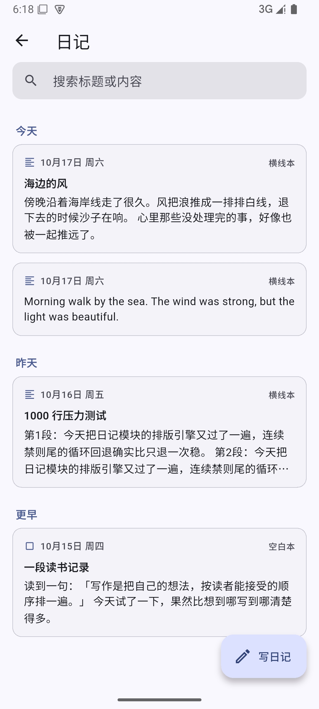
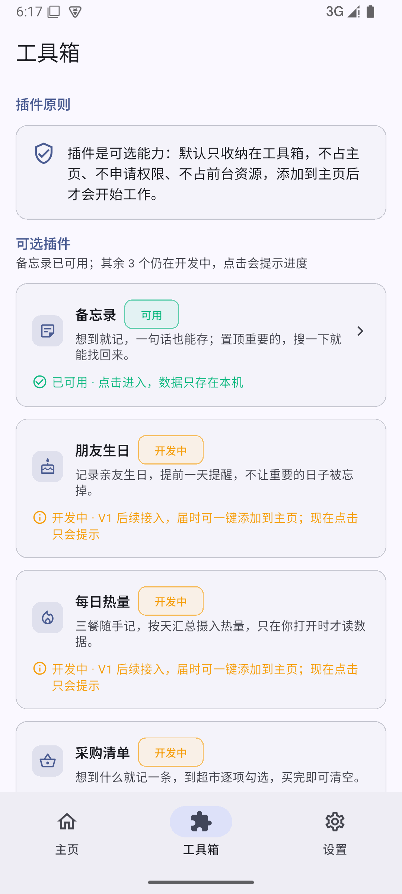
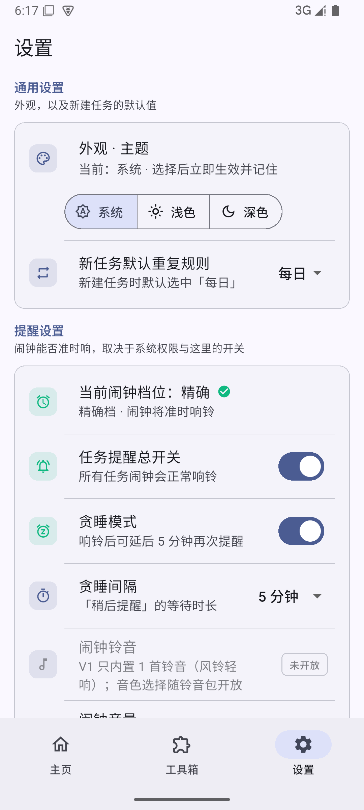

# 效率助手 (Efficiency App) · WorkBuddy 实现

> 一个**纯原生、零云端**的安卓效率应用。任务管理 + 日记 + 工具箱，所有数据留在本地。


---

## 为什么做这个

市面上的待办 App 大多要求登录、同步、订阅。这个项目反着来：

- **不要账号** —— 打开就能用
- **不要网络** —— 飞行模式也能跑
- **不要订阅** —— 没有 Pro 版
- **数据在你手里** —— SQLite 本地存储，可导出 ZIP 备份

目标用户是那种「只想记个事、不想被 App 教育」的人。

---

## 功能

### 任务体系
- 单次 / 每日重复 / 每周重复（可选周几）
- 三态流转：未完成 → 计时中 → 已完成
- **后台计时**：切后台、锁屏都不中断（原生前台服务）
- **精确闹钟**：到点全屏响铃，支持贪睡（3/5/10 分钟）
- 闹钟三档降级：精确档 → 普通档 → 不可用提示
- 重复任务凌晨自动补建实例（惰性 backfill）
- **误触保护**：完成后 5 秒内可撤销；已完成可长按「标记为未完成」并二次确认

### 日记
- 横线本 / 空白本两种模板（横线用 CustomPaint 真实绘制，间距 = 字号 × 1.5）
- 字号 12–32 可调
- **自动保存三重保护**：10 秒定时 + 切后台立即存 + SharedPreferences 草稿兜底
  - 强杀重开后弹「检测到未保存的草稿，要恢复吗？」
- 按日期分组的列表 + 搜索高亮

### 中文排版引擎（技术核心）
自带一套纯 Dart 的 **CJK 避头尾（禁则处理）** 实现，518 行，拆成 5 个文件：

```
engine/
├── cjk_layout.dart      核心布局引擎
├── flow_layout.dart     流式布局
├── line_breaker.dart    断行规则
├── text_measure.dart    文本测量抽象
└── geo.dart             几何工具
```

支持：
- 行首禁则（不能出现在行首的标点）
- 行尾禁则（不能出现在行尾的标点）
- 悬挂标点（hanging punctuation）
- 字距压缩（≤5%，用于消解超宽）
- 增量重排（只重算变化的段落）

> **诚实说明**：这个引擎有完整的单元测试，但 **V1.0 的日记编辑页用的是 Flutter 原生 TextField**，
> 引擎尚未接入 UI。它作为 V2 的准备保留在代码库中。

### 工具箱
- 备忘录（置顶 / 搜索 / 软删除）

### 设置
- 主题：浅色 / 深色 / 跟随系统
- 任务提醒总开关、铃音选择、音量调节
- 精确闹钟权限引导

---

## 技术栈

| 能力 | 选型 | 说明 |
|---|---|---|
| 框架 | Flutter 3.47 / Dart 3.9 | 全原生渲染，无 WebView |
| 状态管理 | Riverpod（手写 Provider） | 不引入 riverpod_generator |
| 数据库 | Drift (SQLite) | **增量迁移**，不删表 |
| 路由 | go_router | |
| 动画 | flutter_animate | |
| 后台计时 | 原生前台服务（Kotlin） | |
| 精确闹钟 | 原生 AlarmManager | 系统级降级链 |

---

## 工程质量

```
flutter analyze    17 issues (0 error, 0 warning)
flutter test       145/145 passed
flutter build apk  app-release.apk 58.9 MB
```

### 值得一看的几个测试

- `migration_test.dart` —— 造 v2 / v3 数据库，验证升级后数据一行不少
- `delete_template_test.dart` —— 验证删除后第二天 backfill 不会复活
- `task_tile_timer_test.dart` —— 验证计时真的在跳（可控时钟 + 逐跳断言）

### 三个已经修掉的 P0

| 问题 | 修复 |
|---|---|
| 升级会清库（`onUpgrade` 是 `deleteTable×5 → createAll()`） | 改逐版本增量迁移，全程无 deleteTable |
| 删除删不掉（只软删实例，明天 backfill 补回来） | 加 `deleteTemplate` + 模板归档 |
| 计时是假的（点一下变蓝后界面再也不动） | `taskTickerProvider` 每秒一跳，只重建计时中那张卡 |

---

## 截图

| 主页 | 日记 | 工具箱 | 设置 |
|---|---|---|---|
|  |  |  |  |

---

## 快速开始

```bash
# 环境要求：Flutter 3.47+ / JDK 17 / Android SDK 34
git clone <this-repo>
cd efficiency_app
flutter pub get
flutter run
```

### 构建 APK

```bash
flutter build apk --release
# 产物：build/app/outputs/flutter-apk/app-release.apk
```

---

## 项目结构

```
lib/
├── app/                  应用根组件、主题
├── core/
│   ├── constants/        颜色、尺寸、动画常量
│   ├── database/         Drift 数据库
│   ├── platform/         原生通道契约
│   └── services/         闹钟服务
├── features/
│   ├── task/             任务体系（domain / data / providers / presentation）
│   ├── diary/            日记（含 CJK 排版引擎）
│   ├── toolbox/          工具箱
│   ├── settings/         设置
│   └── splash/           启动页
└── shell/                底部导航框架
```

---

## 设计原则

> 「不是功能多就冗余，是**找起来方不方便、用起来麻烦不麻烦**。」

- 功能该有的都要有
- 但基础功能必须在 **3 步内**完成
- 不为「极简」砍用户要的功能
- 不为了好看加装饰

---

## 已知限制（V1.1）

**真实存在、且这次没做的**（不是「以后可以加」的功能清单）：

- **编辑态无法接管断行**：`TextField` 的换行在框架内部完成，应用层拿不到断点。
  避头尾 / 悬挂标点只在**预览页**生效；编辑时看到的是原生换行（V2 需自绘 `RenderEditable`）。
- **预览页不内联渲染图片块**：`[[img:…]]` 只按文字排版，页头提示「N 张图片（编辑页查看）」。
- **孤儿图片不回收**：删日记不会删图片文件，只有「在编辑页移除那张图」才删。
- **没有回收站**：删除是软删（`deleted_at`），但没有恢复入口。
- **「从备份恢复」仍是灰化的占位**：能导出 ZIP，不能导入。
- **数据库损坏只能「备份并重建」**：会把坏文件改名保留（`…sqlite.corrupt-时间戳`），
  但应用内**不能**把它读回来；需要人工或后续版本做导入。
- **预览页固定 `TextScaler.noScaling`**：度量与绘制必须同 scale，可访问性交给日记自己的字号滑块。
- **闹钟依赖系统权限**：精确闹钟被拒 → 退到近似档（可能延迟几分钟）；通知权限被拒 → 只有全屏页，没有通知。
- **跨零点行为**：任务列表与火花都会在 00:00 自动换到新的一天（已实测）；
  但火花按「昨天没完成即归零」的口径计算，所以**跨零点那一刻**可能从 N 跳到 0，这是设计如此，不是 bug。

---

## License

[MIT](LICENSE)
